# WinCare

Central de manutenção do Windows com interface moderna. O WinCare reúne diagnóstico, reparo, limpeza e monitoramento em um único app — sem precisar abrir CMD ou PowerShell manualmente.

[](https://github.com/MatheusPereira64/WinCare/releases/latest)
[](https://github.com/MatheusPereira64/WinCare)

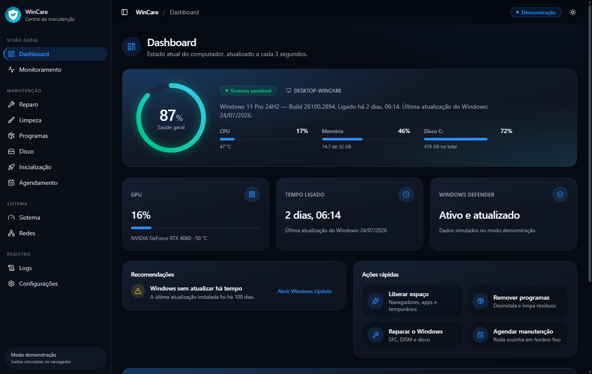

## Prévias das telas

> Imagens geradas no modo demonstração, com dados simulados.

| Limpeza com prévia dos arquivos | Programas |
| --- | --- |
| 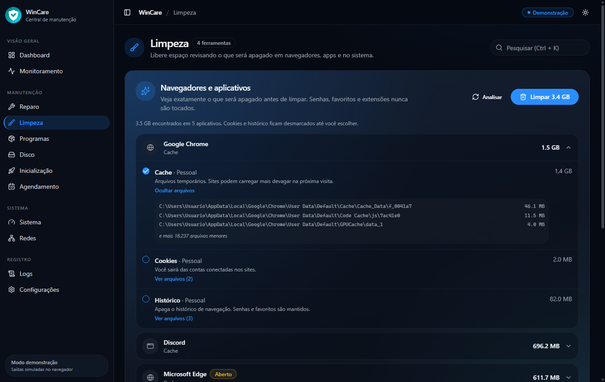 | 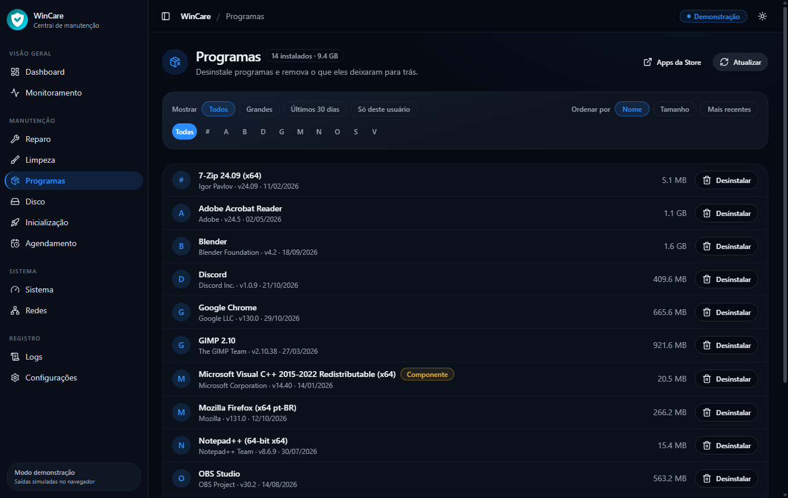 |

| Remoção de resíduos | Ponto de restauração |
| --- | --- |
| 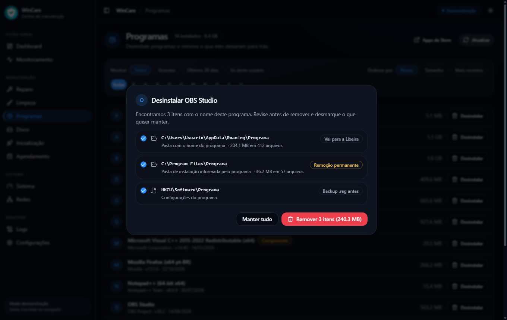 | 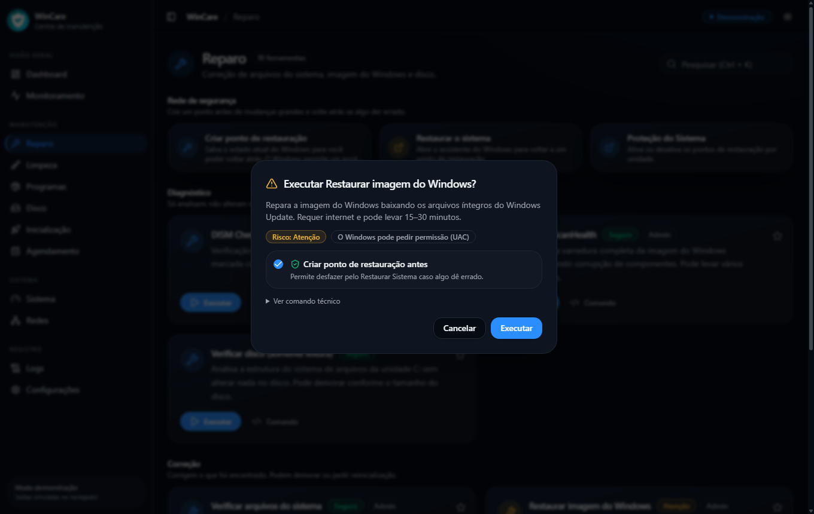 |

| Agendamento | Reparo |
| --- | --- |
| 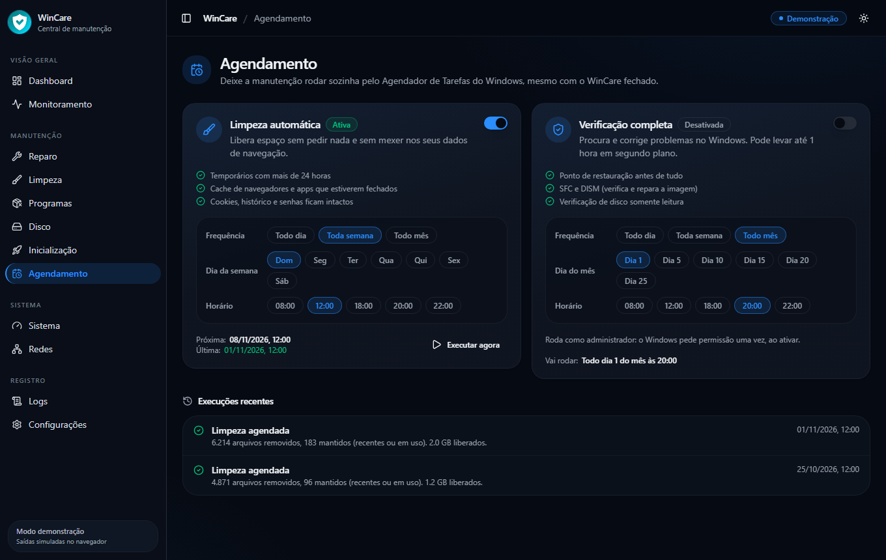 | 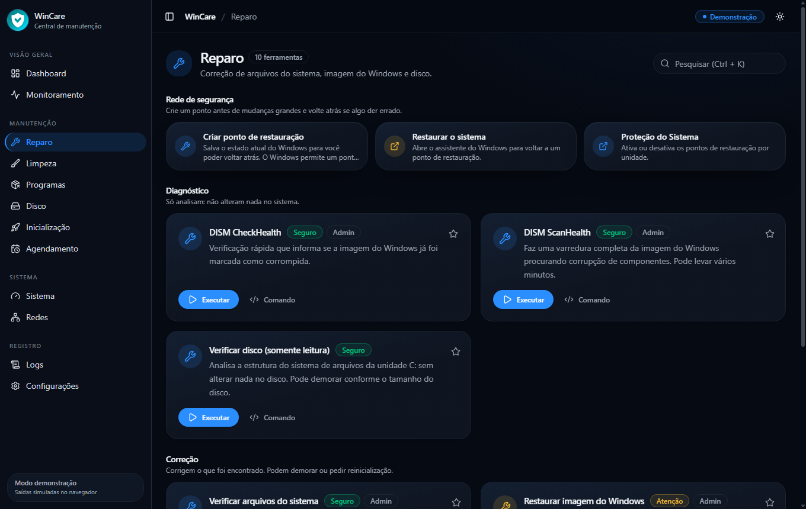 |

| Monitoramento | Disco |
| --- | --- |
| 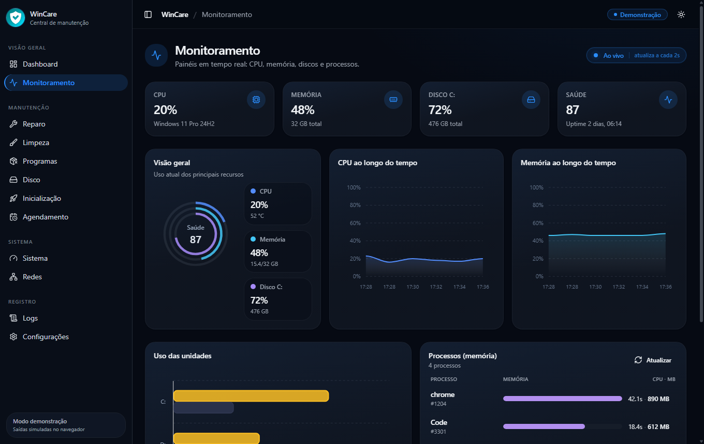 | 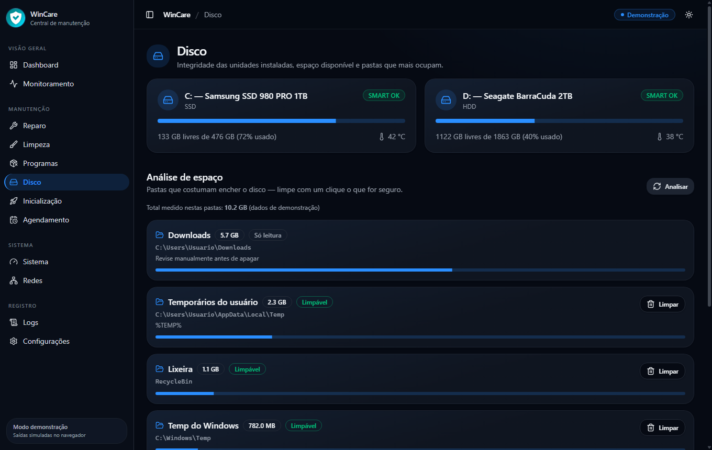 |

| Sistema | Tema claro |
| --- | --- |
| 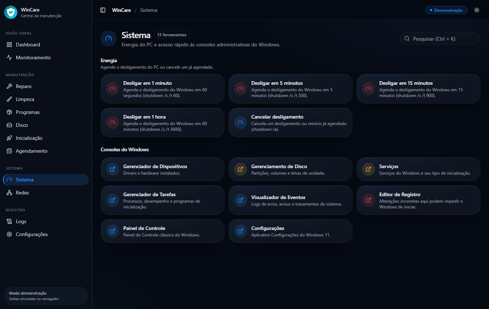 | 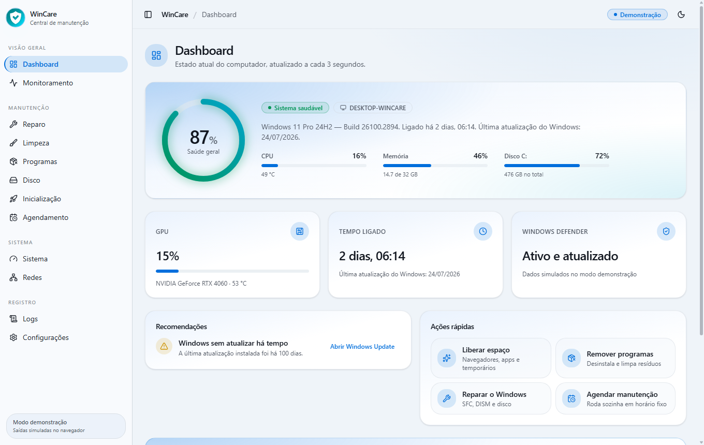 |

Para regerar as imagens: `npm run wincare:screenshots`.

---

## Baixar o aplicativo (usuários)

Não precisa instalar Node.js nem clonar o projeto.

1. Abra a página de **[Releases](https://github.com/MatheusPereira64/WinCare/releases/latest)**
2. Baixe o arquivo **`WinCare-Windows-x64.zip`**
3. Extraia a pasta (botão direito → **Extrair tudo**)
4. Abra **`WinCare.exe`**

### Dicas rápidas

| Situação | O que fazer |
| --- | --- |
| SmartScreen: “Windows protegeu seu PC” | **Mais informações** → **Executar assim mesmo** (o app ainda não tem assinatura digital) |
| Ferramentas que pedem administrador (SFC, DISM…) | Botão direito em `WinCare.exe` → **Executar como administrador** |
| Atualizar | Baixe o ZIP da release mais nova e substitua a pasta antiga |

**Requisito:** Windows 10 ou 11 (64 bits).

---

## Publicar uma nova versão (desenvolvedores)

Quando o código estiver pronto na branch principal:

```powershell
git tag v1.0.0
git push origin v1.0.0
```

O GitHub Actions gera o ZIP automaticamente e publica em **Releases**.

Para testar o pacote localmente:

```powershell
npm run wincare:package
```

Saída: `electron-release/WinCare-Windows-x64.zip`.

---

## Desenvolvimento (modo nativo / demonstração)

> Especificação completa do produto (documento original): [docs/ESPECIFICACAO-ORIGINAL.md](docs/ESPECIFICACAO-ORIGINAL.md)

### Requisitos

- **Windows 10 ou 11**
- **Node.js 22+** e npm
- Conexão com internet (para alguns comandos, como DISM RestoreHealth)

### Dois modos

| Modo | Como abrir | Comportamento |
| --- | --- | --- |
| **Demonstração** | `npm run dev` | Abre no navegador. Métricas e comandos são **simulados**. |
| **Nativo (recomendado)** | `npm run wincare:dev` | App desktop. Executa comandos **reais** no Windows. |

### Instalação

```powershell
git clone https://github.com/MatheusPereira64/WinCare.git
cd WinCare
npm install
npm run wincare:dev
```

### Scripts npm

| Comando | Descrição |
| --- | --- |
| `npm run wincare:dev` | Compila e abre o WinCare (desktop) |
| `npm run wincare:admin` | Compila e abre o WinCare **como administrador** |
| `npm run wincare:dev:debug` | Igual ao dev, com DevTools (F12) |
| `npm run wincare:build` | Compila só a interface em `dist/` |
| `npm run wincare:package` | Gera o ZIP `WinCare-Windows-x64.zip` para distribuição |
| `npm run wincare:clear-data` | Limpa histórico salvo localmente |
| `npm run wincare:screenshots` | Regera as prévias do README (dados simulados) |
| `npm test` | Testa as proteções contra exclusão indevida |
| `npm run dev` | Preview web (modo demonstração) |
| `npm run build` | Build web para produção |
| `npm run lint` | Verifica o código com ESLint |

---

## Funcionalidades do app

### Dashboard

Visão geral do PC: CPU, memória, disco, uptime, Windows Defender, última atualização e **saúde geral (0–100%)**. **Recomendações** calculadas a partir do que foi medido, ações rápidas, ferramentas favoritas e **Verificação completa** (SFC + DISM + disco em sequência).

### Reparo

- Verificação de arquivos do sistema (`sfc /scannow`)
- DISM CheckHealth, ScanHealth e RestoreHealth
- Verificação de disco (`chkdsk`) e correção com confirmação
- Limpeza do cache do Windows Update
- **Ponto de restauração** manual e automático antes de DISM RestoreHealth, `chkdsk /f` e resets de rede. Se falhar, a ação não roda sem a sua confirmação

### Limpeza

**Navegadores e aplicativos com prévia:** Chrome, Edge, Firefox, Brave, Opera, Opera GX e Vivaldi (por perfil), além de Discord, Slack, Spotify, Teams, VS Code e Steam. Você vê o tamanho e os arquivos antes de apagar. Só o cache vem marcado; cookies e histórico são escolhidos por você e ficam bloqueados com o app aberto. Senhas, favoritos e extensões nunca são tocados.

Também limpa arquivos temporários, Prefetch e cache de ícones, com atalho para a Limpeza de Disco nativa (`cleanmgr`).

### Programas

Lista os programas instalados com filtros e ordenação, abre o **desinstalador do próprio programa** e depois procura **resíduos** (pastas e chaves de registro com o nome do programa). Nada é removido sem revisão:

- A busca só roda quando o programa saiu da lista de instalados
- Pastas do sistema, do usuário e usadas por outros programas ficam de fora
- Pastas do usuário vão para a Lixeira; chaves de registro ganham um backup `.reg` antes de sair
- Pastas em `Program Files` e `ProgramData` são removidas permanentemente, com aviso na lista

### Agendamento

Limpeza e verificação completa em horário fixo pelo **Agendador de Tarefas do Windows**, com o WinCare fechado. A limpeza agendada só remove temporários com mais de 24 horas e caches de apps fechados; a verificação cria um ponto de restauração antes e não roda sem ele. O resultado aparece em uma notificação e na tela de Agendamento.

### Disco

Status SMART, espaço por unidade e informações dos volumes.

### Sistema

Atalhos para Gerenciador de Dispositivos, Discos, Serviços, Registro, Eventos, Tarefas, Painel de Controle e Configurações do Windows.

### Monitoramento

Gráficos de CPU e memória em tempo real (modo nativo usa dados reais).

### Logs

Histórico das execuções com opção de copiar logs.

### Configurações

Tema claro/escuro, confirmação de comandos críticos, ponto de restauração automático, avisos ao abrir, **Executar como administrador** e limpeza de dados locais.

---

## Cada ferramenta inclui

- Nome e descrição em português
- Nível de risco: **Seguro**, **Atenção** ou **Avançado**
- Barra de progresso e log em tempo real, que continuam ao trocar de página
- Resultado final e botão **Copiar log**
- Confirmação antes de ações críticas (configurável)

Atalho global: **Ctrl + K** foca a busca de ferramentas na página atual.

---

## Privilégios de administrador

Várias ferramentas (SFC, DISM, limpeza do Windows Update etc.) exigem elevação.

**No modo desenvolvimento**, use:

1. **`npm run wincare:admin`** — recomendado
2. **`WinCare-Admin.cmd`** na raiz do projeto (duplo clique)
3. Botão **Executar como admin** dentro do app (barra superior)

> **Não** execute diretamente `.electron-dev\WinCare.exe` como administrador — sem o caminho do projeto, o Electron abre a tela padrão vazia.

Após baixar o ZIP da Release (ou `npm run wincare:package`), use o `WinCare.exe` — clique com o botão direito → **Executar como administrador**.

---

## Assinatura de código

O pacote já está preparado para assinatura, mas **as releases continuam sem assinatura até existir um certificado**, e por isso o SmartScreen ainda avisa. Com um certificado de assinatura de código (OV/EV, ou um serviço como Azure Artifact Signing ou SignPath):

1. Converta o `.pfx` para base64 e crie os secrets `WINCARE_SIGN_PFX_BASE64` e `WINCARE_SIGN_PASSWORD` no GitHub
2. Crie a próxima tag: o workflow de Release assina `WinCare.exe` e as DLLs antes de gerar o ZIP

Localmente, `npm run wincare:package` usa as mesmas variáveis (ou `WINCARE_SIGN_PFX` com o caminho do arquivo) e exige o `signtool` do Windows SDK. Sem certificado, o passo é pulado com um aviso; com `WINCARE_SIGN_REQUIRED=1`, o build falha em vez de pular.

---

## Dados e logs locais

- Histórico e preferências ficam em `localStorage` do app
- Logs do processo principal: `%APPDATA%\WinCare\logs\wincare.log`
- Backups do registro feitos ao remover resíduos: `%APPDATA%\WinCare\registry-backups\`
- Rotinas agendadas: `%APPDATA%\WinCare\schedules.json` e `schedule-history.json`
- Menu **WinCare → Abrir arquivo de log** (tecla **Alt** no app desktop)
- Limpar histórico: **Configurações → Dados locais** ou `npm run wincare:clear-data`

---

## Solução de problemas

| Problema | O que fazer |
| --- | --- |
| Tela padrão do Electron (“run a local app…”) | Você abriu `.electron-dev\WinCare.exe` sem argumentos. Use `npm run wincare:dev` ou `WinCare-Admin.cmd` |
| Processo aparece como "Electron" | Feche todas as instâncias e rode `npm run wincare:dev` de novo |
| Erro de cache / ICU | Feche o app, apague `.electron-dev/` e execute `wincare:dev` novamente |
| Ferramenta presa em "Executando..." | `npm run wincare:clear-data` e reinicie o app |
| Comandos não rodam de verdade | Use `wincare:dev`, não `npm run dev` (navegador) |
| Duas janelas / app não abre | Só uma instância é permitida; foque a janela existente |
| SmartScreen ao abrir o .exe da Release | **Mais informações** → **Executar assim mesmo** |
| Ponto de restauração falha | Ative a proteção em **Reparo → Proteção do Sistema**. O Windows também limita a um ponto a cada 24 horas |
| Rotina agendada não roda após mover a pasta | Abra **Agendamento** e clique em **Salvar** para apontar para o novo local |

---

## Estrutura do projeto (resumo)

```
WinCare/
├── src/                 # Interface React (rotas, componentes, lógica)
├── electron/            # Shell desktop (main, preload, renderer)
├── scripts/             # Launcher, empacote ZIP, limpeza de dados
├── .github/workflows/   # Release automática no GitHub
├── docs/                # Documentação (especificação original)
└── dist/                # Build da interface (gerado)
```

Detalhes técnicos do Electron: [electron/README.md](electron/README.md).

---

## Licença e origem

Projeto iniciado com [Lovable](https://lovable.dev). O código é seu; alterações no repositório podem ser sincronizadas de volta ao editor Lovable conforme o fluxo do time.
